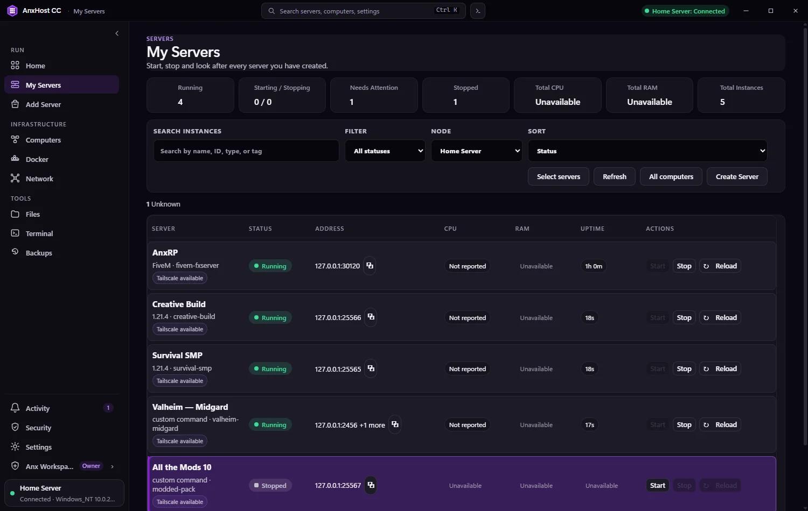
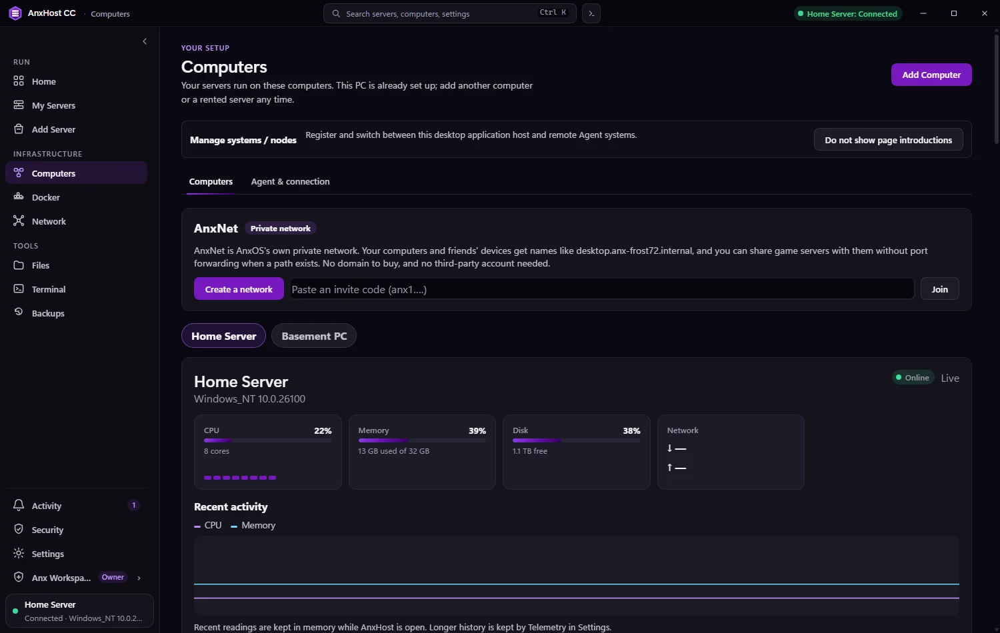
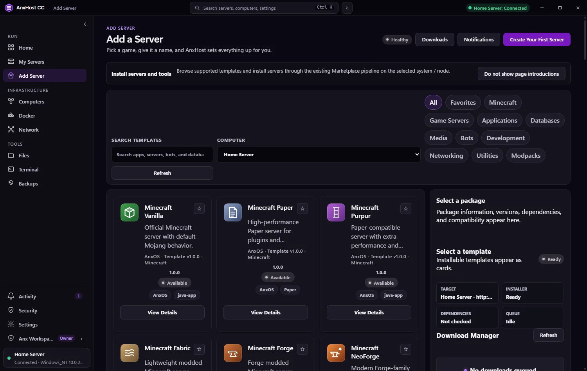
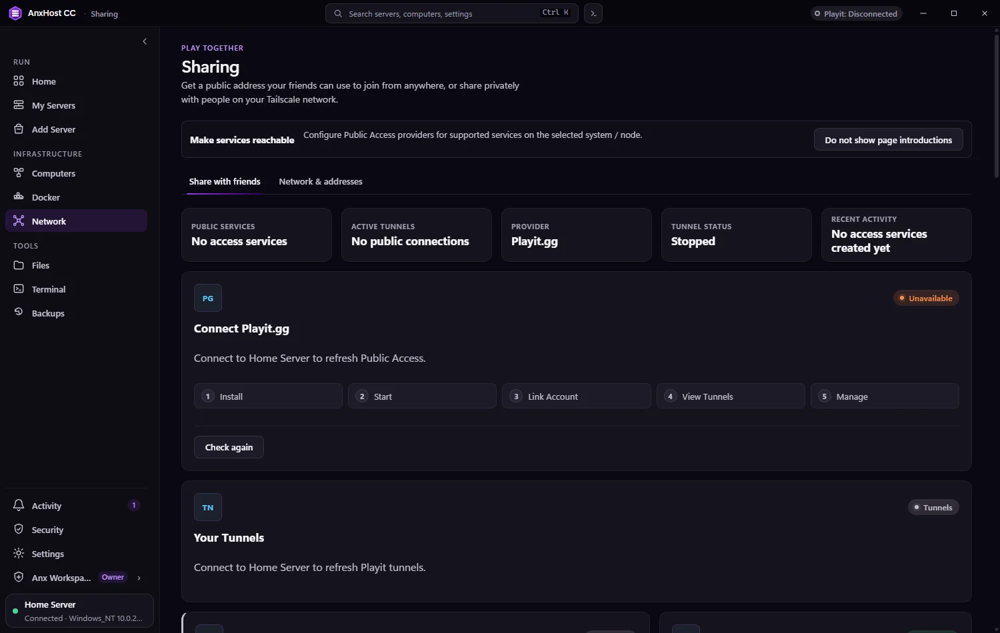

  

<h1 align="center">AnxOS Control Center</h1>

<strong>Your servers. One place to manage them.</strong>

  A desktop app for managing home servers, game servers, and the computers that run them — all from one clean dashboard.

  
  
  

  <a href="https://anxoscontrolcenter.org">Website</a> ·
  <a href="docs/NEW_USER_GUIDE.md">Getting started</a> ·
  <a href="docs/PRIVATE_ALPHA_TESTER_GUIDE.md">Tester guide</a> ·
  <a href="docs/KNOWN_LIMITATIONS.md">Known limitations</a>

---

  

Explore your systems, servers, and activity from a single desktop window.

## What can AnxOS Control Center do?

| | |
| --- | --- |
| 🎮 **Host game servers, beginner-friendly** | Create Minecraft, Palworld, FiveM, Hytale, Rust, Terraria and other supported servers from templates. The app checks what each one needs before it starts. |
| 🖥️ **Manage and monitor servers** | Start, stop and restart servers, read their consoles, and watch health, players, CPU and memory, with alerts when something needs attention. |
| 🧩 **Modrinth and CurseForge** | Install CurseForge server packs, and add or update Minecraft mods from Modrinth with checked downloads. |
| 🐳 **Docker** | See and manage containers, images and volumes on computers that run Docker. |
| 💻 **SSH and remote terminals** | Open terminal sessions to your saved servers from inside the app. |
| 📁 **Local and remote files** | Browse, edit, upload and download server files on this PC or on a connected computer. |
| 🛰️ **Computer Agents** | Pair the other PCs and Linux servers you own with the AnxOS Agent and manage them all from one window. |
| 🌐 **AnxNet private networking** | Put your computers and friends on a private network so servers can be reached without opening ports. Playit, Tailscale and Cloudflare Tunnel are supported too. |
| 📱 **Phone Access** | Use the AnxOS web app on your phone, on your home network, with the role you choose for each phone. |
| 💾 **Backups and recovery** | Back up a whole server or just its world, restore safely, and keep a copy before risky changes. |
| ✨ **Optional AI assistance** | An optional assistant, off until an Owner turns it on, that explains problems and suggests next steps. |

**Built for homelabs, personal servers, and game-server hosts.** Available tools depend on the connected machine and the services installed on it.

## Install

1. Download the latest release from **[anxoscontrolcenter.org/download](https://anxoscontrolcenter.org/download)** or the **[latest GitHub release](https://github.com/AnxLabs/AnxOS-Control-Center-Releases/releases/latest)**.
   - **Windows 11 x64:** run the signed `AnxOS-Control-Center-Setup-<version>.exe` installer.
   - **Debian or Ubuntu x64 desktop:** install the `.deb`, or run the `.AppImage`.
   - **Headless Debian 11+ / Ubuntu 22.04+ server:** install `AnxOS-Agent-<version>.deb`, then pair it from the app.
2. Check the download if you like: every release publishes a `SHA256SUMS` file, and the Windows installer is Authenticode-signed with Azure Trusted Signing. The [Releases README](https://github.com/AnxLabs/AnxOS-Control-Center-Releases#verify-your-download) shows how.
3. Open the app and follow the setup. Updates are offered from inside the app.

## A closer look

<table>
<tr>
<td width="50%" align="center">
   
  <strong>Manage your servers</strong>
</td>
<td width="50%" align="center">
   
  <strong>Keep track of your computers</strong>
</td>
</tr>
<tr>
<td width="50%" align="center">
   
  <strong>Discover server templates</strong>
</td>
<td width="50%" align="center">
   
  <strong>Review your connection options</strong>
</td>
</tr>
</table>

Screenshots are from the project and may differ slightly between builds.

## How does it work?

1. **Open Control Center** on your Windows or Linux desktop.
2. **Connect a computer** using AnxOS Agent — a small companion service that runs on the machine you want to manage.
3. **Manage it from the app.** View its status, create supported servers, work with files, and handle updates without switching between multiple tools.

New here? Follow the [step-by-step user guide](docs/NEW_USER_GUIDE.md). You don't need to start with a terminal to use the normal setup flow.

### Pair a computer

Normal users should pair Agents from the app, without npm commands, shell commands, environment-variable editing, or manual token synchronization.

1. On the computer you want to manage, get a pairing code:
   - **Windows or desktop Linux:** install AnxOS Control Center there, open **Agent Control**, select **Connect this computer**, turn on **Another computer will connect to this one**, then select **Generate Pairing Code**.
   - **Headless Debian or Ubuntu server:** install the AnxOS Agent package from the releases page, run the guided setup, choose **Pair**, and copy the code it shows.
2. In this Control Center, select **Add Computer**, paste the full code into **Pair with Code**, and select **Pair Agent**.

Pairing codes expire and work once; they are not the permanent Agent credential. After pairing, the app and the Agent set up a permanent credential on their own, store it securely and never show it again. **Advanced Manual Setup** in the same dialog is for recovery and older Agents.

## Availability

<!-- anxos-release:current:start -->
<!-- Generated by scripts/release-docs.js from website/config.js. Edit outside these markers. -->
> [!IMPORTANT]
> **Current release: [AnxOS Control Center v2.0 Build 212 — Private Alpha](https://github.com/AnxLabs/AnxOS-Control-Center-Releases/releases/tag/v2.0-build212)**, released November 16, 2026.
> Download it from [anxoscontrolcenter.org/download](https://anxoscontrolcenter.org/download) or the [latest GitHub release](https://github.com/AnxLabs/AnxOS-Control-Center-Releases/releases/latest). What changed: [release notes](https://anxoscontrolcenter.org/release-notes).
<!-- anxos-release:current:end -->

AnxOS Control Center is **Private Alpha**: it is being tested with a limited group of trusted users and is **not yet a public beta or a generally available stable release**. Some features need specific host software, permissions, or additional validation.

The desktop app targets **Windows 11 x64 and Debian/Ubuntu x64**, with a companion Agent for headless Debian 11+ and Ubuntu 22.04+ servers. See [Known Limitations](docs/KNOWN_LIMITATIONS.md) for what is still being tested.

For news and product information, visit **[anxoscontrolcenter.org](https://anxoscontrolcenter.org)**.

## Guides and resources

| Looking for… | Start here |
| --- | --- |
| First-time setup | [New User Guide](docs/NEW_USER_GUIDE.md) |
| Private tester instructions | [Private Alpha Tester Guide](docs/PRIVATE_ALPHA_TESTER_GUIDE.md) |
| Feature availability and caveats | [Known Limitations](docs/KNOWN_LIMITATIONS.md) |
| Development, builds, and advanced recovery | [Developer Guide](docs/DEVELOPER_GUIDE.md) |
| Architecture, tests, and project history | [Documentation Index](docs/DOCUMENTATION_INDEX.md) |
| How this repository is organized | [Repository Map](docs/REPOSITORY_MAINTENANCE.md) |

<strong>For developers</strong>

This is an Electron desktop app with a separate AnxOS Agent. If you're working from source, see the [Developer Guide](docs/DEVELOPER_GUIDE.md), [Test Commands](docs/TEST_COMMANDS.md), and [Development Protocol](AGENTS.md). Normal users should follow the in-app setup instead of running development commands.

The app repairs Playit dependencies and services in-app. Shell commands for a headless host where that flow is unavailable are kept in the Developer Guide under [Advanced Playit Service Recovery](docs/DEVELOPER_GUIDE.md#advanced-playit-service-recovery).

---

  <strong>Made with care by AnxLabs.</strong> 
  Keep control of your servers — without the clutter.

