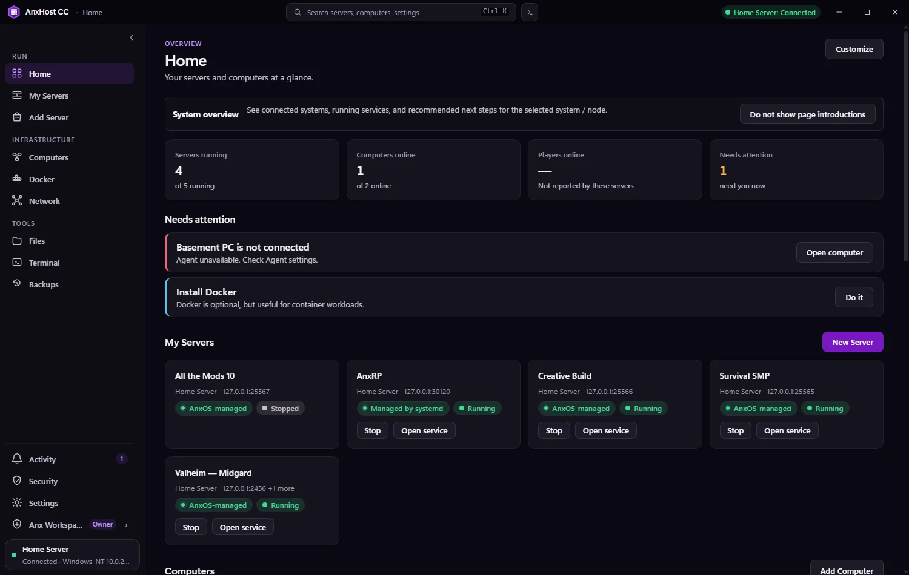

  

<h1 align="center">AnxOS Control Center</h1>

  <strong>Run game servers and look after the computers you own, from one app.</strong> 
  No command line needed for the normal setup.

  
  
  

  <a href="https://anxoscontrolcenter.org/download"><strong>⬇️ Download</strong></a> &nbsp;·&nbsp;
  <a href="https://anxoscontrolcenter.org/getting-started/"><strong>🚀 Getting started</strong></a> &nbsp;·&nbsp;
  <a href="docs/DOCUMENTATION_INDEX.md"><strong>📚 Documentation</strong></a>

  

## In 30 seconds

**AnxOS Control Center is a desktop app for Windows and Linux.** You use it to run game servers, like Minecraft or Palworld, on your own PC or on other computers you own, and to keep an eye on those computers.

Hosting a server usually means juggling a download page, a terminal, a file manager, a backup script, a tunnel tool so friends can join, and maybe a Docker dashboard. **AnxOS puts all of that in one window**, checks what each server needs before it starts, and tells you in plain words when something is wrong.

> [!NOTE]
> AnxOS is in **Private Alpha**: a small group of testers uses it on real machines. It works, but expect rough edges and bugs between builds.

## What works today

| | |
| --- | --- |
| 🎮 **Create and run game servers** | Pick a template (Minecraft, Palworld, FiveM, Rust, Terraria and more), and AnxOS installs it, checks it has what it needs, and starts it. Start, stop, restart and read the server console from the app. |
| 🤝 **Let friends join** | Turn on sharing and AnxOS gives you an address friends can join from anywhere, using Playit, without opening ports on your router. |
| 🖥️ **Manage your other computers** | Install AnxOS (or the small **AnxOS Agent** on a Linux server) on another computer you own, pair it with a one-time code, and manage it from the same window. |
| 📁 **Files and backups** | Browse and edit server files, upload and download them, back up a whole server or just its world, and restore it. |
| 🐳 **Docker** | See and control the Docker apps on your computers (explained below). |
| 💻 **SSH terminal** | Open a terminal on your servers without leaving the app (explained below). |
| 🔔 **Health and alerts** | See which servers and computers are up, their CPU and memory, who's playing, and what needs attention. |

## Early and experimental

These exist and you can try them, but they're newer and less tested. Treat them as previews.

| | |
| --- | --- |
| 🌐 **AnxNet** | Your own private network (explained below). New in the 2.0 builds and still being tested across real networks. |
| ✨ **AI assistant** | Optional and **off by default**. An Owner turns it on in Settings. |
| 📱 **Phone Access** | Use the AnxOS web app on your phone, on your home network. |
| 🧩 **Mods and game updates** | The Mod Manager handles Minecraft mods from Modrinth only. Game updates can be applied for SteamCMD games (like Palworld); others are check-only. Hytale runs on Linux computers only. |

The full list of caveats is in [Known Limitations](docs/KNOWN_LIMITATIONS.md).

## Words you'll see, in plain English

- **AnxOS Agent:** a small background helper on each computer you manage. It does the actual work (starting servers, reading files) when the app asks.
- **AnxNet:** a private network just for your computers, and friends you invite. Devices on it can reach each other's servers as if they were on the same home Wi-Fi, without opening ports on your router.
- **Docker:** a popular way to run apps inside sealed boxes called *containers*. If a computer uses Docker, AnxOS lists those apps and lets you start, stop and restart them and read their logs. You don't need Docker to host game servers.
- **SSH:** a secure way to type commands on another computer. AnxOS opens that terminal for you inside the app, using a connection you saved once.
- **AI assistant:** when it's turned on, it reads your servers' status and logs and explains what's wrong and what to try next. Anything that would change something waits for you to click **Approve**.

## Where it's heading

This is the goal, not today's product:

> Pick a game, click **Create**, and send a friend a link. No networking knowledge, no port forwarding, no command line.

**Today** you're most of the way there: creating a server is a few guided steps, and sharing works once Playit or AnxNet is set up. Each build closes more of that gap.

## Get started

1. **Download** the app from [anxoscontrolcenter.org/download](https://anxoscontrolcenter.org/download).
   - **Windows 11 (64-bit):** run the installer.
   - **Debian or Ubuntu desktop:** use the `.deb` or the `.AppImage`.
   - **A Linux server with no screen:** install the AnxOS Agent `.deb`, then pair it from the app.
2. **Open AnxOS** and follow the setup. It checks your PC and tells you if anything is missing.
3. **Create your first server** from the templates, and press Start.

<strong>Add another computer</strong>

Normal users should pair Agents from the app, without npm commands, shell commands, environment-variable editing, or manual token synchronization.

1. On the computer you want to add, get a pairing code:
   - **Windows or Linux desktop:** install AnxOS there, open **Agent Control**, choose **Connect this computer**, turn on **Another computer will connect to this one**, and select **Generate Pairing Code**.
   - **Linux server with no screen:** install the AnxOS Agent package, run its guided setup, choose **Pair**, and copy the code.
2. On your main PC, select **Add Computer**, paste the code into **Pair with Code**, and select **Pair Agent**.

A pairing code works once and expires soon. After pairing, the two computers set up their own permanent key and keep it safe; you never see or copy it.

New to all this? The [step-by-step guide](docs/NEW_USER_GUIDE.md) walks through it. Downloads are signed (Windows) and checksummed; the [Releases page](https://github.com/AnxLabs/AnxOS-Control-Center-Releases#verify-your-download) shows how to check them.

## Current release

<!-- anxos-release:current:start -->
<!-- Generated by scripts/release-docs.js from website/config.js. Edit outside these markers. -->
> [!IMPORTANT]
> **Current release: [AnxOS Control Center v2.0 Build 215 — Private Alpha](https://github.com/AnxLabs/AnxOS-Control-Center-Releases/releases/tag/v2.0-build215)**, released November 20, 2026.
> Download it from [anxoscontrolcenter.org/download](https://anxoscontrolcenter.org/download) or the [latest GitHub release](https://github.com/AnxLabs/AnxOS-Control-Center-Releases/releases/latest). What changed: [release notes](https://anxoscontrolcenter.org/release-notes).
<!-- anxos-release:current:end -->

## Documentation

| I want to… | Read |
| --- | --- |
| Set it up for the first time | [New User Guide](docs/NEW_USER_GUIDE.md) |
| Test it as a Private Alpha tester | [Tester Guide](docs/PRIVATE_ALPHA_TESTER_GUIDE.md) |
| Know what isn't finished yet | [Known Limitations](docs/KNOWN_LIMITATIONS.md) |
| Report a problem | [Open an issue](https://github.com/AnxLabs/AnxOS-Control-Center/issues) with your build number and what happened. Never paste passwords, tokens or pairing codes. |
| Find everything else | [Documentation Index](docs/DOCUMENTATION_INDEX.md) |

<strong>For developers</strong>

AnxOS Control Center is an Electron desktop app with a separate Node.js Agent. To work from source, start with the [Developer Guide](docs/DEVELOPER_GUIDE.md), [Test Commands](docs/TEST_COMMANDS.md), the [Development Protocol](AGENTS.md) and the [Repository Map](docs/REPOSITORY_MAINTENANCE.md). How releases and the website stay in sync is in [Release documentation](docs/RELEASE_DOCUMENTATION.md).

The app repairs Playit itself. Shell commands for a headless host where that isn't possible are kept in the Developer Guide under [Advanced Playit Service Recovery](docs/DEVELOPER_GUIDE.md#advanced-playit-service-recovery).

---

  <strong>Made with care by AnxLabs</strong> · <a href="https://anxoscontrolcenter.org">anxoscontrolcenter.org</a> 
  Keep control of your servers, without the clutter.

